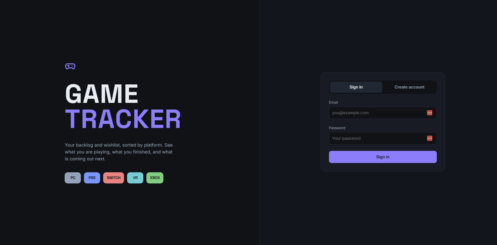

# Game Tracker

A small web app to track the games I want to play and the ones I've finished. Each user gets their own list. It uses the IGDB game database for search, so I can look a game up and have the fields filled in automatically.



Stack: nginx + plain HTML/JS frontend, FastAPI backend, Postgres. Everything runs in Docker Compose.

I also use this app as the example app for the Kubernetes setup in my homelab. The deploy steps are in "Kubernetes setup" below.

## What it does

- Sign up needs a code, so only people I give the code to can make an account
- Add a game with its platform (PS5, Xbox, Switch 2, PC, VR or Other) and a status: wishlist, playing or completed
- Search IGDB when adding a game to fill in the title, release date, developer and cover art ( or add it manually)
- Rate each game 0 to 10, mark favorites, and keep notes and a store link
- Search and filter your list by title, platform, status, released games and favorites, and sort by title or release date
- A summary of how many games you have by platform and by status
- Change your name, email or password, or delete your account

## Security

- Passwords are hashed, never stored as plain text
- Logins use signed tokens (JWT) that expire
- Every game query filters on the logged-in user, so nobody can see another user's games
- Sign up needs a code
- The CI pipeline runs gitleaks (leaked secrets), CodeQL (code problems) and Trivy (image vulnerabilities, a HIGH or CRITICAL finding fails the build)

## Project layout

- `api/`: the FastAPI backend, its tests and the database migrations (Alembic)
- `web/`: the nginx frontend (plain HTML, CSS and JS)
- `chart/`: the Helm chart for Kubernetes
- `docker-compose.yml`: runs everything locally
- `.github/workflows/` and `.gitlab-ci.yml`: the CI pipelines

## Local Docker - how to run

You need Docker and Python 3.13.

1. Clone the repo and go into it

```
git clone <repo url>
cd game-tracker
```

2. Make a `.env` file in the repo root

```
POSTGRES_PASSWORD=pick-a-password
SECRET_KEY=any-long-random-string
SIGNUP_CODE=pick-a-code
IGDB_CLIENT_ID=your-twitch-client-id
IGDB_CLIENT_SECRET=your-twitch-client-secret
```

Keep the password to letters and numbers only.

`SIGNUP_CODE` is the code you type in the Create account form. Without one, nobody can sign up. IGDB logs in through Twitch, so the two IGDB values are the Client ID and Client Secret of an app you register at https://dev.twitch.tv/console. Without them the game search doesn't work.

3. Start the database

```
docker compose up -d db
```

4. Create the tables (one time)

```
cd api
python -m venv .venv
.venv\Scripts\activate
pip install -r requirements.txt
copy .env.example .env
```

Open `api/.env` and put your password in `DATABASE_URL`, then:

```
alembic upgrade head
cd ..
```

On Mac/Linux use `source .venv/bin/activate` and `cp` instead.

5. Start everything

```
docker compose up -d --build
```

Go to http://localhost:8080 and make an account.

## Stop it

```
docker compose down
```

Add `-v` to also delete the database.

## Tests

```
cd api
pip install -r requirements-dev.txt
pytest
```


## Kubernetes setup

Game-tracker is the app I run on the Kubernetes cluster in my [homelab_infra](https://github.com/cel6586/homelab_infra) repo. The Helm chart and the CI pipelines for game-tracker are in this repo (`chart/`, `.github/workflows/`, `.gitlab-ci.yml`). Everything that isn't specific to game-tracker (the VMs, the cluster, Vault, monitoring) is in homelab_infra.

### What the chart deploys

- `api` and `web`, 2 replicas each
- Postgres
- a migration job that creates the database tables
- an ingress so the site is reachable
- a backup CronJob: every night at 03:00 it dumps Postgres to S3, and it can also copy the dump to Garage on my `docker-services` VM

The image tag and the registry settings are in `chart/values.yaml`.

### Before you deploy

The homelab_infra cluster has to be up first (cluster, Argo CD, Vault, External Secrets). Then you need the secrets and the runner below.

#### Namespace

The namespace has to exist before the secrets, so create it first if it isn't there yet:

```
kubectl create namespace game-tracker
```

#### Secrets

The app needs these Secrets in the `game-tracker` namespace. None of them are in git.

| Secret | Keys inside it | What it's for |
|---|---|---|
| `game-tracker-secrets` | `POSTGRES_PASSWORD` | Password for the database user `gtadmin`. Postgres, the api, the migration job and the backup job all use it |
| | `SECRET_KEY` | The api's secret key. Any long random string |
| | `SIGNUP_CODE` | The code a new user has to enter to make an account. With no code set, nobody can sign up |
| | `IGDB_CLIENT_ID`, `IGDB_CLIENT_SECRET` | Login for the IGDB API, used for the game search |
| `ghcr-pull` | `.dockerconfigjson` | Login the cluster uses to pull the images from GHCR |
| `gitlab-pull` | `.dockerconfigjson` | Same, for the GitLab registry. Only needed if you deploy from GitLab |
| `aws-backup` | `AWS_ACCESS_KEY_ID`, `AWS_SECRET_ACCESS_KEY` | The key for the S3 bucket the nightly backup uploads to |
| `local-backup` | `AWS_ACCESS_KEY_ID`, `AWS_SECRET_ACCESS_KEY` | The key for the Garage bucket (the second backup copy). Only needed if `backup.local.enabled` is true in `values.yaml` |
| `cloudflare-tunnel` | `token` | Token for the Cloudflare Tunnel that `cloudflared` uses |

The key names are fixed. The chart looks for exactly these names, so they have to match the table.

I setup the infrastructure with Vault to safely store the keys.  If not using Vault, the keys can just be applied directly to k8 with a create secret command

**Without Vault.** Create each Secret yourself with `kubectl`. Put the values in a file outside the repo, one `KEY=value` per line, so they don't end up in your shell history:

```
kubectl create secret generic game-tracker-secrets -n game-tracker --from-env-file=game-tracker-secrets.env
kubectl create secret generic aws-backup -n game-tracker --from-env-file=aws-backup.env
kubectl create secret generic local-backup -n game-tracker --from-env-file=local-backup.env
kubectl create secret generic cloudflare-tunnel -n game-tracker --from-literal=token=<tunnel token>
kubectl create secret docker-registry ghcr-pull -n game-tracker --docker-server=ghcr.io --docker-username=<github user> --docker-password=<token with read:packages>
```

**With Vault** Put the values in Vault, in the KV v2 engine at `secret/`, using the keys in the table:

| Vault path | Keys |
|---|---|
| `game-tracker/app` | the five keys of `game-tracker-secrets` |
| `game-tracker/aws-backup` | `AWS_ACCESS_KEY_ID`, `AWS_SECRET_ACCESS_KEY` |
| `game-tracker/local-backup` | `AWS_ACCESS_KEY_ID`, `AWS_SECRET_ACCESS_KEY` |
| `game-tracker/ghcr-pull` | `.dockerconfigjson` (the whole JSON as the value) |
| `game-tracker/gitlab-pull` | `.dockerconfigjson` |
| `game-tracker/cloudflare-tunnel` | `token` |

The External Secrets operator reads those paths using `apps/game-tracker/external-secrets.yml` in homelab_infra and creates the Kubernetes Secrets above. It refreshes them every hour.  To check the secrets are there -
```
kubectl get externalsecret -n game-tracker
```


#### The runner for the automated deploy

The `deploy` job in `.github/workflows/build.yml` runs on a self-hosted runner with the label `homelab`. Without it, a push to `main` builds and pushes the images but never deploys. The runner has to be on a machine that can reach the cluster, with `helm` installed and a kubeconfig at `~/.kube/config`. Mine is on the `k8s` VM.

1. In GitHub: the `game-tracker` repo > Settings > Actions > Runners > New self-hosted runner (Linux x64). The page shows the download commands and a one-time token. 
2. Follow the instructions on the page to install the runner on the k8 VM

3. Install it as a service so it keeps running after a reboot:

```
sudo ./svc.sh install
sudo ./svc.sh start
```

`sudo ./svc.sh status`. should show as Idle on the GitHub Runners page.

### Deploy

**Automated CI/CD method:** push to `main`. GitHub Actions tests, builds and deploys it (see "CI/CD" below).

**Manual Method:** from the root of this repo, with `kubectl` pointed at the cluster:

```
helm upgrade --install game-tracker chart \
  --namespace game-tracker \
  --create-namespace \
  --set image.tag=<commit sha> \
  --wait
```

- `<commit sha>` Replace with the tag of the API/WEB images in GHCR.  It will fail if a current tag on the registry is not picked

Then check it:

```
kubectl get pods -n game-tracker
```

**Roll back a bad deploy:** list the releases, then go back to a good one:

```
helm history game-tracker -n game-tracker
helm rollback game-tracker <revision> -n game-tracker
```

**GitLab:** `.gitlab-ci.yml` runs the same test, build and deploy steps on my own GitLab. This was for practice to try switching my code and pipeline over to a self hosted gitlab instead of github

### Open the site

**Inside my network:** the ingress host is `game-tracker.homelab.internal`. Add it to the hosts file on your PC, pointing at the IP of the k8s VM:

```
<ip address> game-tracker.homelab.internal
```

Then open `https://game-tracker.homelab.internal`. The certificate comes from the homelab CA in homelab_infra, so the browser shows a warning until you trust that CA on your PC.

**From the internet:** I bought a cloudfare domain and setup a tunnel (the `cloudflared` deployment and the `cloudflare-tunnel` secret), open the tunnel in the Cloudflare dashboard, go to Routes, and add a published application with your hostname and the service `http://web:8080`. Then open that hostname.

### CI/CD

The pipeline is GitHub Actions (`.github/workflows/`).

**On every pull request and every push to `main`:**

- `test`: runs `pytest` and `ruff check`
- `secret-scan`: gitleaks scans the git history for leaked secrets
- `CodeQL` (its own workflow): analyzes the Python code. It also runs every Monday at 06:00

**Only on a push to `main`, after `test` and `secret-scan` pass:**

- `build`: builds the api and web images, scans each one with Trivy, then pushes both to GHCR tagged with the commit SHA. A HIGH or CRITICAL vulnerability that has a fix fails the build
- `deploy`: runs on the self-hosted runner and runs `helm upgrade --install` with `--set image.tag=<commit sha> --wait`

Because the images are tagged with the commit SHA, every deploy maps to one commit. `--wait` makes the deploy job fail if the pods don't become ready.

### Backups

A CronJob (`pg-backup`) dumps the database every night at 03:00 and uploads the dump to S3. If `backup.local.enabled` is true, it also uploads a copy to Garage. The bucket names and endpoints are in `chart/values.yaml`. 

